# MCP — Carte directrice unique : objectifs, architecture, histoire et reprise

> **Index documentaire NON AUTORITAIRE.** Cette page fédère les sources déjà versionnées ; elle ne remplace ni `main`, ni les autorités Governed Task Queue / Session / Locks, ni les attestations exact-SHA. Date de consolidation : 2026-10-23. Baseline observée : `main@a3df3b01f65cd6c212cf9948b68cd8531c6e76d5`. Toute affirmation de statut courant exige réobservation.

## 1. Racine et contrat de continuité

- **Seul ancrage directeur** : [issue #235, commentaire #6352010236](https://github.com/Patricked-code/MCP/issues/235#issuecomment-6352010236).
- **Addendum historique initial** : [#6352050351](https://github.com/Patricked-code/MCP/issues/235#issuecomment-6352050351).
- **Traces subordonnées, non concurrentes** : [#6352521624](https://github.com/Patricked-code/MCP/issues/235#issuecomment-6352521624), [#6352543890](https://github.com/Patricked-code/MCP/issues/235#issuecomment-6352543890), [#6352716263](https://github.com/Patricked-code/MCP/issues/235#issuecomment-6352716263) (PR #19–27), [#6352746353](https://github.com/Patricked-code/MCP/issues/235#issuecomment-6352746353) (PR #28–39).
- **Entrée agent existante** : [AGENTS.md](../../AGENTS.md), [CLAUDE.md](../../CLAUDE.md), [SUIVI.md](../../SUIVI.md), [README gouvernance](README.md), [fil d'Ariane inter-agents](agent-historical-continuity-breadcrumbs-20261016.md). Le commentaire [#6203867094](https://github.com/Patricked-code/MCP/issues/235#issuecomment-6203867094) reste une directive historique de reprise, pas une seconde racine.

## 2. Objectif final et frontières

**Objectif** : converger vers un MCP gouverné, sûr, observable, récupérable et exploitable par plusieurs agents/clients autorisés, avec identités et tâches durables, mémoire, coordination, GitHub-first, OIDC, déploiement exact-SHA, rollback et preuves de fonctionnement. `GLOBAL_MCP_COMPLETE` exige une acceptation terminale démontrée, pas une simple PR fusionnée.

**Frontières** : uniquement `Patricked-code/MCP` ; ne pas confondre avec les autorités des autres dépôts/organisations. Pas de nouvelle Task, session, claim, queue ou permission créée par ce document. Pas d'écriture de code directement sur S1 ; GitHub → vérifications → déploiement gouverné. Réutiliser les capacités existantes avant de proposer un nouvel élément. Ne pas reprendre l'ownership des PR #207, #88–90 ou issues #262/#268 sans vérifier les autorités.

## 3. Mind map — navigation et dépendances conceptuelles

```mermaid
flowchart TD
  R["Issue #235 · racine documentaire #6352010236"]
  R --> H["HISTOIRE · décisions / commentaires / abandons"]
  R --> A["ARCHITECTURE CIBLE · 94 blueprints"]
  R --> P["PROGRAMME · PCM-00 à PCM-14 / GWB-00 à 09"]
  R --> O["AUTORITÉS LIVE · GitHub / Queue / Sessions / Locks / S1"]
  H --> H1["PR #1–64 · collecte partielle et liens de supersession"]
  H --> H2["Issue/PR #65+ · 6 lots archivés"]
  H --> H3["GWB-02 revues · GWB-03 triage"]
  A --> A1["Gouvernance / identité / ownership / anti-collision"]
  A --> A2["Operational Memory / BUS / reprise inter-agents"]
  A --> A3["GitHub OIDC / OAuth clients / API"]
  A --> A4["Live State / observabilité / déploiement exact-SHA"]
  P --> P1["Audit & réconciliation PCM-00..05"]
  P --> P2["OAuth / connexion PCM-06..08"]
  P --> P3["Exécution gouvernée PCM-09..11"]
  P --> P4["Cockpit / autonomie / acceptation PCM-12..14"]
  O --> O1["HEAD / PR / CI / Deploy"]
  O --> O2["Claims / scopes / locks / receipts"]
  O --> O3["Attestations runtime S1/Docker"]
```

Cette carte est **une navigation**, pas un nouveau schéma d'implémentation. Les frontières détaillées et les 94 éléments se trouvent dans [architecture-94-blueprint-crosswalk-20261009.json](architecture-94-blueprint-crosswalk-20261009.json), [Program Backlog V2](program-backlog-convergence.json) et [ARCHITECTURE.md](../../ARCHITECTURE.md). Ne pas confondre architecture cible historique et architecture actuellement certifiée.

## 4. Étapes chronologiques après la collecte documentaire

| Phase | Travail | Sortie exigée |
|---|---|---|
| 0 — PCM-00..01 | Reprise sûre ; consolider l'historique sans refaire les archives | Matrice de couverture et liens exacts |
| 1 — PCM-02..04 | Trier les constats contre le HEAD actuel ; certifier les 94 blueprints par preuves et tests ; dédupliquer les intentions | Matrice `DONE/PARTIAL/BLOCKED/UNKNOWN/SUPERSEDED`, écarts réels |
| 2 — PCM-05 | Réconcilier backlog, propriétaires, dépendances et verrous ; faire valider les lots admissibles | Plan de réalisation gouverné, sans queue parallèle |
| 3 — PCM-06..08 | Diagnostiquer et corriger OAuth/consentement/refresh déjà en cours ; tester Claude/ChatGPT | Preuves client et sécurité, sans réappropriation #207 |
| 4 — PCM-09..11 | Réobserver Queue/Session/Locks ; exécuter lots compatibles ; certifier tracing, Live State et déploiement | CI exact-head, reviews, Governed Deploy, attestations |
| 5 — PCM-12..13 | Cockpit Super Admin gouverné ; reprise et orchestration autonome multi-agents | Tests négatifs, concurrence, anti-doublons, permissions |
| 6 — PCM-14 | Acceptation intégrale et convergence finale | `GLOBAL_MCP_COMPLETE` uniquement sur preuves terminales |

**Source de l'ordre exact et des chevauchements autorisés :** [mcp-priority-convergence-map-20261015.json](mcp-priority-convergence-map-20261015.json). [Workblock GWB-00..09](governed-audit-continuation-workblock-20261009.json) et [Program Backlog](program-backlog-convergence.json) restent les détails de planning. Les phases ne constituent pas une barrière artificielle : audits indépendants et tâches déjà autorisées peuvent coexister sans collision.

## 5. Corpus historique et décisions abandonnées

| Sources | Ce qui est acquis | Lacunes à combler |
|---|---|---|
| [Chronologie #65+](architecture-chronology-issue65-20261009.json) et six lots `architecture-comments-batch01..06-20261009.json` | 208 entrées archivées à la date du lot | #1–64 ; conversations ultérieures ; liens vers versions retenues |
| [GWB-02](gwb02-review-coverage-manifest-20261015.json) | 135 PR, 282 inline, 215 soumissions de revue dans son périmètre daté | Commit comments non vérifiés ; résolution des fils non classée |
| [GWB-03](gwb03-pr-review-findings-triage-20261015.json) | 158 observations historiques P1/P2 | Résolution individuelle contre HEAD/tests/runtime |
| [Audit forensique août](../audits/2026-08-05/README.md) | Causes et décisions initiales | Relier aux PR et évolutions postérieures |
| [Traces #19–27](https://github.com/Patricked-code/MCP/issues/235#issuecomment-6352716263) | #19 gelée ; #20→#22→#26 ; #21→#25 ; #23→#27 ; preview non livrée | Revues complémentaires et preuves exactes de production |
| [Traces #28–39](https://github.com/Patricked-code/MCP/issues/235#issuecomment-6352746353) | #33 gelée ; #34 réintégration ; #35–39 évolution gouvernée | Compléter commentaires/reviews, puis #40–64 |

**Règle de classification** : `DONE` seulement sur preuves du niveau visé ; `PARTIAL`, `DESIGNED`, `READY`, `BLOCKED`, `UNKNOWN`, `SUPERSEDED`, `ABANDONED_FOR_PRODUCTION`, `HISTORICAL_EVIDENCE` selon les sources. Une PR fermée sans fusion peut contenir une idée reprise ailleurs ; une CI verte ne prouve pas un déploiement.

## 6. Protocole de reprise et point d'arrêt

1. Lire **racine #6352010236**, puis la **dernière trace liée** sur #235, cette carte et les fichiers d'entrée.
2. Relever le HEAD GitHub, PR/CI/Deploy et les autorités runtime pertinentes. Toute photographie datée doit être revalidée.
3. Identifier la **dernière tranche vérifiée**, les sources exactes, les trous et l'ownership. Ne jamais ré-extraire les 6 lots #65+ ou GWB-02/GWB-03 sans delta identifié.
4. Continuer **PR #40–64** : descriptions, commentaires de conversation, reviews, fils et relations de supersession ; rapprocher `SUIVI.md`, audits et code. Ensuite combler les deltas #65+ post-baseline, branches et commentaires sur commits si accessibles.
5. Publier sur **issue #235** une trace subordonnée avec `ROOT`, `PARENT`, baseline SHA, périmètre, preuves URLs/IDs, `DONE/UNKNOWN`, décisions, limites, `NEXT_ACTION` et critère d'acceptation. Ne jamais présenter cette trace comme un second checkpoint directeur.
6. Après collecte, appliquer PCM-02..14 via **les autorités existantes**, avec revue, CI et attestations exact-SHA ; ne pas déclarer d'exécution sans preuve.

**Point d'arrêt de cette édition** : la carte est une **proposition documentaire sur branche**, non encore fusionnée ; son contenu n'est pas une validation de l'architecture cible complète ni une certification de l'état courant. **NEXT_ACTION :** revue indépendante de la carte et de ses liens, vérification CI, puis fusion gouvernée éventuelle ; continuer la collecte PR #40–64 sans collision documentaire.

## 7. Registre de provenance — PR #40–63 (lecture du 23/10/2026)

> **Portée et limites :** métadonnées et corps des 24 PR #40 à #63 relus directement via GitHub ; commentaires, reviews, fils inline, commits et état runtime présent **non exhaustivement vérifiés**. La mention « fusionnée » atteste seulement la fusion GitHub. Ne pas réutiliser les attestations historiques comme preuves live.

| PR | Classification documentaire et observation | Lien / successeur |
|---|---|---|
| [#40](https://github.com/Patricked-code/MCP/pull/40) | MERGED — état S1 bootstrap bloqué, divergence GitHub/S1 documentée ; pas d'alignement déclaré | #41–43 |
| [#41](https://github.com/Patricked-code/MCP/pull/41) | MERGED — force-recreate Docker, contrôle /health fail-closed | #42 |
| [#42](https://github.com/Patricked-code/MCP/pull/42) | MERGED — activation autodeploy, readiness polling borné | #43 |
| [#43](https://github.com/Patricked-code/MCP/pull/43) | MERGED — preuves du premier déploiement automatique ; attestation historique | #39–42 |
| [#44](https://github.com/Patricked-code/MCP/pull/44) | MERGED — Governed Session Continuity / Operational Memory V1 | #45 |
| [#45](https://github.com/Patricked-code/MCP/pull/45) | MERGED — corrections de rétention sessions/locks | #46–48 |
| [#46](https://github.com/Patricked-code/MCP/pull/46) | MERGED — réconciliation documentaire production PR #45 | #45 |
| [#47](https://github.com/Patricked-code/MCP/pull/47) | MERGED — correctifs tardifs sur expiration sessions/locks et cohérence S1 | #48 |
| [#48](https://github.com/Patricked-code/MCP/pull/48) | MERGED — réconciliation documentaire PR #47 | #47 |
| [#49](https://github.com/Patricked-code/MCP/pull/49) | MERGED — bootstrap agent obligatoire et orchestration, sans seconde autorité | #50 DUPLICATE |
| [#50](https://github.com/Patricked-code/MCP/pull/50) | CLOSED_UNMERGED — doublon exact de #49, ne pas compter comme livraison | #49 |
| [#51](https://github.com/Patricked-code/MCP/pull/51) | MERGED — attestation documentaire post-déploiement #49 | #49 |
| [#52](https://github.com/Patricked-code/MCP/pull/52) | MERGED — durcissement cycle de vie des tâches gouvernées | #53→#54 |
| [#53](https://github.com/Patricked-code/MCP/pull/53) | CLOSED_UNMERGED — candidat documentaire non livré, ascendance à ne pas reprendre | #54 |
| [#54](https://github.com/Patricked-code/MCP/pull/54) | MERGED — réconciliation documentaire propre après #52 | #53 remplacée |
| [#55](https://github.com/Patricked-code/MCP/pull/55) | MERGED — Unified Operational Work State, composition des autorités existantes | #56/#57→#58 |
| [#56](https://github.com/Patricked-code/MCP/pull/56) | CLOSED_UNMERGED — tentative documentaire de réconciliation, pas livraison | #58 |
| [#57](https://github.com/Patricked-code/MCP/pull/57) | CLOSED_UNMERGED — carrier documentaire remplacé sans nouveau périmètre fonctionnel | #58 |
| [#58](https://github.com/Patricked-code/MCP/pull/58) | MERGED — réconciliation documentaire de #55 | #56/#57 |
| [#59](https://github.com/Patricked-code/MCP/pull/59) | CLOSED_UNMERGED — carrier draft bootstrap, problème de mutation GraphQL Draft→Ready | #60 |
| [#60](https://github.com/Patricked-code/MCP/pull/60) | MERGED — automatic governed connection session binding, continuité du même candidat | #59 |
| [#61](https://github.com/Patricked-code/MCP/pull/61) | CLOSED_UNMERGED — carrier draft correctif transport/session revision | #62 |
| [#62](https://github.com/Patricked-code/MCP/pull/62) | MERGED — préservation révisions optimistes à travers changements de transport | #61 |
| [#63](https://github.com/Patricked-code/MCP/pull/63) | MERGED — réconciliation documentaire après déploiement bootstrap | #62 |

**Synthèse de provenance :** chaîne #40–43 (bootstrap/déploiement) → #44–48 (Operational Memory + rétention) → #49–54 (agent bootstrap / tâche gouvernée) → #55–58 (état opérationnel unifié) → #59–63 (connexion/session/transport). Cette chaîne est une **trajectoire documentaire**, pas une dépendance technique démontrée entre toutes les PR.

**Contrôles restant à faire :** (a) lire commentaires/reviews/fils/commits de #40–63 ; (b) identifier les décisions, objections et corrections non visibles dans les corps ; (c) rapprocher les attestations exact-SHA et le HEAD courant ; (d) prolonger la classification aux PR #64+, sans ré-extraire les lots déjà archivés ; (e) rapprocher les audits historiques de la matrice GWB et des 94 blueprints. Chaque UNKNOWN reste explicite.

**Trace de publication :** issue #235, sous l'ancrage #6352010236. Ce registre reste une proposition de la PR #348 tant que celle-ci n'est pas fusionnée.

## 8. Registre des reviews et corrections — échantillon vérifié #44/#45/#49/#55/#60 (23/10/2026)

> Collecte directe des timelines GitHub de PR #44 (10 entrées), #45 (10), #49 (10), #52 (0), #55 (21), #59 (0), #60 (5), #61 (2) : **58 entrées normalisées** (commentaires de conversation, inline et soumissions de revue). Les entrées automatiques de revue ne sont pas assimilées à des constats supplémentaires. Cette collecte n'est pas l'exhaustivité des 24 PR #40–63. Les résolutions ci-dessous sont **déclarations documentées historiquement**, non validation du HEAD courant.

| Origine et finding | Impact historique | Correction / preuve historique | Vérification actuelle |
|---|---|---|---|
| [#44 P1 sessions](https://github.com/Patricked-code/MCP/pull/44#discussion_r3773882530) | 1 000 sessions historiques saturent le store | [#45 réponse](https://github.com/Patricked-code/MCP/pull/44#discussion_r3790243915), rétention déterministe | UNKNOWN |
| [#44 P1 locks](https://github.com/Patricked-code/MCP/pull/44#discussion_r3773882539) | 2 000 locks historiques bloquent l'acquisition | [#45 réponse](https://github.com/Patricked-code/MCP/pull/44#discussion_r3790244006) | UNKNOWN |
| [#44 P2 fermeture](https://github.com/Patricked-code/MCP/pull/44#discussion_r3773882550) | lock actif orphelin après fermeture de session | [#45 réponse](https://github.com/Patricked-code/MCP/pull/44#discussion_r3790244061) | UNKNOWN |
| [#45 P1 grâce reprise](https://github.com/Patricked-code/MCP/pull/45#discussion_r3790243613) | session EXPIRED encore reprenable supprimée | [#47 réponse](https://github.com/Patricked-code/MCP/pull/45#discussion_r3834269463) | UNKNOWN |
| [#45 P1 exception docs S1](https://github.com/Patricked-code/MCP/pull/45#discussion_r3790243614) | Live State ne peut atteindre FULLY_ALIGNED après descendant docs-only | [#47 réponse](https://github.com/Patricked-code/MCP/pull/45#discussion_r3834269207) | UNKNOWN |
| [#45 P2 lock TTL](https://github.com/Patricked-code/MCP/pull/45#discussion_r3790243616) | lock expiré logiquement bloque rétention à capacité | [#47 réponse](https://github.com/Patricked-code/MCP/pull/45#discussion_r3834269341) | UNKNOWN |
| [#49 P1 task owner terminal](https://github.com/Patricked-code/MCP/pull/49#discussion_r3835756530) | tâche CLAIMED inaccessible après session terminale | [#52 réponse](https://github.com/Patricked-code/MCP/pull/49#discussion_r3884320674), suite 234/234 historique | UNKNOWN |
| [#49 P2 currentTask](https://github.com/Patricked-code/MCP/pull/49#discussion_r3835756533) | tâche d'une autre session ou terminée sélectionnée | [#52 réponse](https://github.com/Patricked-code/MCP/pull/49#discussion_r3884320585) | UNKNOWN |
| [#49 P2 evidenceHead](https://github.com/Patricked-code/MCP/pull/49#discussion_r3835756536) | preuves working-tree attribuées à tort au SHA HEAD | [#52 réponse](https://github.com/Patricked-code/MCP/pull/49#discussion_r3884320786) | UNKNOWN |
| [#55 P1 exact-head checks](https://github.com/Patricked-code/MCP/pull/55#discussion_r3885879622) | head_sha lu sur mauvaise structure API | [correction](https://github.com/Patricked-code/MCP/pull/55#discussion_r3886764738), CI #577 historique | UNKNOWN |
| [#55 P1 déploiement tâche](https://github.com/Patricked-code/MCP/pull/55#discussion_r3885879624) | déploiement d'une autre tâche peut certifier celle-ci | [correction](https://github.com/Patricked-code/MCP/pull/55#discussion_r3886764992) | UNKNOWN |
| [#55 P1 règles cumulées](https://github.com/Patricked-code/MCP/pull/55#discussion_r3886743714) | règles applicables à main omises | [correction](https://github.com/Patricked-code/MCP/pull/55#discussion_r3886765233) | UNKNOWN |
| [#55 P2 approvals](https://github.com/Patricked-code/MCP/pull/55#discussion_r3886743720) | compte minimal d'approbations ignoré | [correction](https://github.com/Patricked-code/MCP/pull/55#discussion_r3886765547) | UNKNOWN |
| [#55 P1 integration_id](https://github.com/Patricked-code/MCP/pull/55#discussion_r3886769822) | check d'une autre GitHub App accepté à tort | correction ultérieure à identifier | UNKNOWN |
| [#55 P2 code owners](https://github.com/Patricked-code/MCP/pull/55#discussion_r3886769824) | contrainte code-owner ignorée | correction ultérieure à identifier | UNKNOWN |
| [#55 P2 optional checks](https://github.com/Patricked-code/MCP/pull/55#discussion_r3886769828) | échec check facultatif bloque faussement Task Reality | correction ultérieure à identifier | UNKNOWN |
| [#60 P1 documentation bootstrap](https://github.com/Patricked-code/MCP/pull/60#discussion_r3897408270) | comportement auto-resume non documenté dans autorités canoniques | [réponse #62/#63](https://github.com/Patricked-code/MCP/pull/60#discussion_r3898746098), attestation historique Live State 66 | UNKNOWN |

**Attention à #55 :** le fil contient des corrections intermédiaires suivies de **trois nouveaux constats tardifs** ; ne jamais marquer l'ensemble des findings comme clos sur la seule base de CI #577. À rapprocher des PR successeures, GWB-02/GWB-03, tests et code actuel.

**NEXT_ACTION :** terminer les autres timelines #40–63 ; extraire la résolution précise des trois findings tardifs #55 ; vérifier les commits et tests des PR #45/#47/#52/#55/#62/#63 ; publier le lot suivant sur #235 ; poursuivre #64–98 et #99–273 par deltas.

## 9. Reprise PR #64–95 et compléments de reviews #40–63 (23/10/2026)

**Couverture attestée :** métadonnées, titres, statuts de fusion et débuts de corps des **32 PR #64–95** ; les descriptions complètes de chaque PR, les commits et reviews de ce lot restent à relire. Sur les 24 PR #40–63, les timelines des 16 PR restantes ont été interrogées ; ensemble les 24 PR ont une première passe de commentaires/reviews via GitHub. Cette première passe n'est pas une certification d'exhaustivité des fils, commits, pages de commentaires ni de leur résolution.

### PR #64–95 — index individuel

| PR | État de fusion vérifié | Objet et relation de provenance |
|---|---|---|
| [#64](https://github.com/Patricked-code/MCP/pull/64) | MERGED | ROADMAP/TODO/TASKS, planification documentaire gouvernée |
| [#65](https://github.com/Patricked-code/MCP/pull/65) | MERGED | Stabilisation checkpoint SUIVI sans SHA autoréférentiel |
| [#66](https://github.com/Patricked-code/MCP/pull/66) | MERGED | Réconciliation baseline GitHub/S1/runtime |
| [#67](https://github.com/Patricked-code/MCP/pull/67) | CLOSED_UNMERGED | Carrier draft Governed Connection Context, remplacé par #68 |
| [#68](https://github.com/Patricked-code/MCP/pull/68) | MERGED | Minimal Governed Connection Context, même branche que #67 |
| [#69](https://github.com/Patricked-code/MCP/pull/69) | CLOSED_UNMERGED | Carrier docs-only #68, remplacé par #70 |
| [#70](https://github.com/Patricked-code/MCP/pull/70) | MERGED | Réconciliation A2.1, même branche que #69 |
| [#71](https://github.com/Patricked-code/MCP/pull/71) | CLOSED_UNMERGED | Carrier draft clôture A2.1, remplacé par #72 |
| [#72](https://github.com/Patricked-code/MCP/pull/72) | MERGED | Clôture documentaire A2.1, même branche/head que #71 |
| [#73](https://github.com/Patricked-code/MCP/pull/73) | MERGED | Résolution du principal GitHub contextualisé |
| [#74](https://github.com/Patricked-code/MCP/pull/74) | MERGED | Attestation documentaire livraison B1 / #73 |
| [#75](https://github.com/Patricked-code/MCP/pull/75) | MERGED | Résolution dépôt GitHub fail-closed B2 |
| [#76](https://github.com/Patricked-code/MCP/pull/76) | MERGED | Réconciliation documentaire B2 / #75 |
| [#77](https://github.com/Patricked-code/MCP/pull/77) | MERGED | Correction tardive fermeture session gouvernée B2 |
| [#78](https://github.com/Patricked-code/MCP/pull/78) | MERGED | Fondation de compatibilité projet GitRegistry |
| [#79](https://github.com/Patricked-code/MCP/pull/79) | MERGED | Réconciliation AfricaFunds phase 1 / #78 |
| [#80](https://github.com/Patricked-code/MCP/pull/80) | MERGED | Mapping des composants AfricaFunds dans registre existant |
| [#81](https://github.com/Patricked-code/MCP/pull/81) | MERGED | Réconciliation terminale AfricaFunds phase 2 / #80 |
| [#82](https://github.com/Patricked-code/MCP/pull/82) | MERGED | Correction ordre des baselines SUIVI |
| [#83](https://github.com/Patricked-code/MCP/pull/83) | MERGED | C1 readiness d'activation GitRegistry V2 fail-closed |
| [#84](https://github.com/Patricked-code/MCP/pull/84) | MERGED | Réconciliation documentaire C1 / #83 |
| [#85](https://github.com/Patricked-code/MCP/pull/85) | CLOSED_UNMERGED | Projet transport GitHub Actions→SSH, intention historique non activée |
| [#86](https://github.com/Patricked-code/MCP/pull/86) | CLOSED_UNMERGED | Candidat sync/deploy S2 Stablecoin, intention non livrée par cette PR |
| [#87](https://github.com/Patricked-code/MCP/pull/87) | MERGED | Test RED d'attestation de surface client G3 |
| [#88](https://github.com/Patricked-code/MCP/pull/88) | CLOSED_UNMERGED | Candidat création repo organisation, intention historique |
| [#89](https://github.com/Patricked-code/MCP/pull/89) | CLOSED_UNMERGED | Candidat fondation Git/GitHub Control Plane empilé sur #88 |
| [#90](https://github.com/Patricked-code/MCP/pull/90) | CLOSED_UNMERGED | Candidat cycle de vie GitHub empilé sur #89 |
| [#91](https://github.com/Patricked-code/MCP/pull/91) | MERGED | Réconciliation G3 après merge |
| [#92](https://github.com/Patricked-code/MCP/pull/92) | MERGED | C2 Repository→Project Resolution |
| [#93](https://github.com/Patricked-code/MCP/pull/93) | MERGED | Réconciliation terminale C2 |
| [#94](https://github.com/Patricked-code/MCP/pull/94) | MERGED | Fondation design-only Governed Workflow Contract, 73 GW IDs |
| [#95](https://github.com/Patricked-code/MCP/pull/95) | MERGED | Dossier canonique GWC R3, 18 blueprints GWC-0..17 ; voir section dédiée et PR #96 |

**Ne pas confondre :** les PR #85/#86/#88/#89/#90 sont des intentions historiques fermées sans fusion ; leur fonctionnalité peut avoir été livrée par d'autres PR mais ce statut ne le prouve pas. Les #67/#69/#71 sont des carriers remplacés, pas des livraisons indépendantes.

### Findings additionnels #40–63 identifiés dans les timelines

| Source | Constat historique | Suivi |
|---|---|---|
| [#41 P2](https://github.com/Patricked-code/MCP/pull/41#discussion_r3767942148) | readiness après recréation Docker | [réponse #42](https://github.com/Patricked-code/MCP/pull/41#discussion_r3771730004) |
| [#42 P1](https://github.com/Patricked-code/MCP/pull/42#discussion_r3771723869) | déploiements push concurrents non sérialisés | correction exacte à vérifier |
| [#47 P1](https://github.com/Patricked-code/MCP/pull/47#discussion_r3790278796) | logs de gouvernance non mis à jour avec rétention | [réponse](https://github.com/Patricked-code/MCP/pull/47#discussion_r3790284890) |
| [#47 P1](https://github.com/Patricked-code/MCP/pull/47#discussion_r3790289781) | TASKS.md contradictoire sur tâche rouverte | [réponse](https://github.com/Patricked-code/MCP/pull/47#discussion_r3790294841) |
| [#51 P2a](https://github.com/Patricked-code/MCP/pull/51#discussion_r3835771028) | drift Live State vs PRODUCTION_STATE.json | résolution à vérifier |
| [#51 P2b](https://github.com/Patricked-code/MCP/pull/51#discussion_r3835771031) | DEPLOYMENT_PRODUCTION.md périmé | résolution à vérifier |
| [#54 P2](https://github.com/Patricked-code/MCP/pull/54#discussion_r3884615036) | comptage erroné #50 comme fusionnée | [réponse](https://github.com/Patricked-code/MCP/pull/54#discussion_r3884818950) |
| [#58 P1](https://github.com/Patricked-code/MCP/pull/58#discussion_r3886818109) | état gouverné non réconcilié dans tous les fichiers | résolution à vérifier |
| [#62 P2](https://github.com/Patricked-code/MCP/pull/62#discussion_r3898673175) | reprise durable de sessions dépassant idle TTL | résolution à vérifier |
| [#63 P2](https://github.com/Patricked-code/MCP/pull/63#discussion_r3898735626) | outcome `IN_USE` inexistant dans contrat | résolution à vérifier |

**NEXT_ACTION :** revue complète des timelines/commits #64–95, puis #96–128, avec priorité #94/#95/#96 et filiations GWC ; rechercher résolutions P1/P2 ouvertes dans la carte ; publier checkpoint lié à #235 et mettre à jour les mêmes registres. Aucune affirmation de résolution sur le HEAD actuel sans preuve.

## 10. Index des PR #96–135 — numérotation partagée issues/PR (23/10/2026)

**Méthode :** interrogation individuelle du point de lecture GitHub PR pour chacun des 40 numéros #96–135 ; **19 PR trouvées**, **21 réponses 404 au point PR**. 404 signifie uniquement « pas de pull request accessible à ce numéro avec ce compte », **pas** « issue inexistante ». Première passe : titre, fusion, début du corps ; reviews, commits, diff et runtime non exhaustifs.

| PR vérifiée | Fusion | Résultat documentaire |
|---|---|---|
| [#96](https://github.com/Patricked-code/MCP/pull/96) | OUI | Réconciliation historique de la production GWC #95 ; SHA exact documenté, pas live actuel |
| [#97](https://github.com/Patricked-code/MCP/pull/97) | OUI | Handoff mémoire canonique GWC post-intégration, `docs/gwc/canonical-memory/current.json` |
| [#98](https://github.com/Patricked-code/MCP/pull/98) | OUI | Correction de dérive du handoff terminal GWC ; description vide, inspecter diff |
| [#99](https://github.com/Patricked-code/MCP/pull/99) | OUI | Stablecoin S2 : cartographie gouvernée lecture seule, distincte du candidat non fusionné #86 |
| [#100](https://github.com/Patricked-code/MCP/pull/100) | OUI | GitHub-first continuité opérationnelle et fallback de preuve lecture seule |
| [#102](https://github.com/Patricked-code/MCP/pull/102) | OUI | GitHub Actions OIDC → endpoint evidence readonly → commandes bornées S1/S2 |
| [#104](https://github.com/Patricked-code/MCP/pull/104) | OUI | Probes S2 Stablecoin backend/runtime lecture seule |
| [#108](https://github.com/Patricked-code/MCP/pull/108) | OUI | Diagnostics fail-soft probes S2 après erreurs HTTP 502 |
| [#111](https://github.com/Patricked-code/MCP/pull/111) | OUI | Diagnostics bornés d'échecs evidence GitHub-first sans fuite de corps/stderr |
| [#117](https://github.com/Patricked-code/MCP/pull/117) | OUI | Fast-forward Stablecoin S2 borné et gouverné via GitHub |
| [#124](https://github.com/Patricked-code/MCP/pull/124) | OUI | Préservation de la surface client @GitHub avant escalade bridge |
| [#126](https://github.com/Patricked-code/MCP/pull/126) | OUI | AF-09 : source des SHA documentaires depuis état de production structuré, non premier SHA de SUIVI |
| [#127](https://github.com/Patricked-code/MCP/pull/127) | OUI | Réconciliation post-merge AF-09 |
| [#130](https://github.com/Patricked-code/MCP/pull/130) | OUI | Corrections existant-first AF-10, AF-18, AF-24, AF-27 |
| [#133](https://github.com/Patricked-code/MCP/pull/133) | OUI | Réconciliation baseline production des quatre AF de #130 |

**Rectification du décompte :** 15 PR trouvées et 25 réponses 404 sur la plage #96–135 (40 numéros). Ne pas confondre « numéro 404 au point PR » et absence d'issue.

**Numéros non résolus comme PR lors de cette passe :** #101, #103, #105–107, #109–110, #112–116, #118–123, #125, #128–129, #131–132, #134–135. Ils devront être examinés par l'API *issues*, non déclarés manquants.

**Chaînes :** #94→#95→#96→#97→#98 (GWC mémoire et handoff) ; #100→#102→#111 (GitHub-first / evidence OIDC) ; #99→#104→#108 (Stablecoin S2 observation) ; #126→#127 (AF-09), #130→#133 (AF-10/18/24/27). Une filiation thématique n'est pas preuve de dépendance code.

**NEXT_ACTION :** examiner issues portant les numéros sans PR, corps complets et reviews des 15 PR trouvées ; lire le diff #98 et les documents GWC ; poursuivre #136–175 et publier les deltas liés à l'issue #235. Aucune autorité runtime créée.

## 11. Index PR #136–175 — première passe GitHub (23/10/2026)

**Couverture :** 40 numéros vérifiés individuellement au point GitHub PR ; **12 PR identifiées, toutes fusionnées** ; **28 numéros non trouvés comme PR**, à rechercher séparément comme issues. Première passe de titres/statuts uniquement pour ce lot ; ne pas déclarer les reviews/diffs/commits audités.

| PR | Observation vérifiée | Filiation / vigilance |
|---|---|---|
| [#136](https://github.com/Patricked-code/MCP/pull/136) | AF-23 : lier checkpoints Operational Memory aux événements journal | #139 |
| [#139](https://github.com/Patricked-code/MCP/pull/139) | Réconciliation findings corrigés et baseline AF-23 | #136 |
| [#142](https://github.com/Patricked-code/MCP/pull/142) | Clôture documentaire de baseline des findings corrigés | #139 |
| [#145](https://github.com/Patricked-code/MCP/pull/145) | Réconciliation des intentions PR historiques ouvertes | #85/#86/#88/#89/#90 |
| [#146](https://github.com/Patricked-code/MCP/pull/146) | Handoff vers main de candidats historiques fusionnés | #149 |
| [#149](https://github.com/Patricked-code/MCP/pull/149) | Baseline documentaire du handoff des candidats | #146 |
| [#154](https://github.com/Patricked-code/MCP/pull/154) | Généralisation heartbeat agents et observabilité claims | #168 |
| [#159](https://github.com/Patricked-code/MCP/pull/159) | Convergence du backlog programme exhaustif, projection non exécutable | #171 |
| [#164](https://github.com/Patricked-code/MCP/pull/164) | Probe bornée inventaire métadonnées backend Stablecoin | #99/#104/#108 |
| [#168](https://github.com/Patricked-code/MCP/pull/168) | Réconciliation terminale déploiement UAC | #154 |
| [#171](https://github.com/Patricked-code/MCP/pull/171) | Program Backlog V2, graphe de planification sans seconde Task Queue | #159→#174 |
| [#174](https://github.com/Patricked-code/MCP/pull/174) | W1 convergence d'état du programme | #171 |

**Non trouvés comme PR :** #137–138, #140–141, #143–144, #147–148, #150–153, #155–158, #160–163, #165–167, #169–170, #172–173, #175. L'API issues reste à examiner.

**Point de contrôle :** l'ensemble #96–175 est indexé au niveau PR existence/fusion ; aucun statut d'issue ni résolution de review ne peut être inféré de l'absence de PR. La mémoire GWC #97 et le graphe de planification #171 sont des sources de nature différente de l'état runtime actuel.

**NEXT_ACTION :** lectures issues et timelines #96–175 ; index PR #176–215 puis #216–273 ; croisement des constats GWB-02/GWB-03 et des 94 blueprints ; publier traces subordonnées à la racine issue #235.

## 12. Registre des PR #176–273 — première passe intégrale de numéros (23/10/2026)

**Méthode :** 98 numéros #176–273 interrogés un par un sur le point GitHub PR, en distinguant PR vérifiées et numéros qui ne sont pas accessibles comme PR. Couverture ici = existence, titre et fusion, **pas** commentaires/reviews/diff/commits exhaustifs. Chaque PR ci-dessous est **MERGED**, sauf #207 **NON MERGED**. Les numéros non listés ne sont pas des PR accessibles dans cette passe et doivent être recherchés comme issues.

### #176–215 — W2/W3, transport SSH, OAuth, preuves et présence client

| PR | Observation / type |
|---|---|
| [#176](https://github.com/Patricked-code/MCP/pull/176) | W2 GitHub READ complémentaires |
| [#178](https://github.com/Patricked-code/MCP/pull/178) | Intake #177 → Program Backlog V2 |
| [#181](https://github.com/Patricked-code/MCP/pull/181) | Automatisation de continuation Program Backlog |
| [#184](https://github.com/Patricked-code/MCP/pull/184) | Handoff documentaire auto-continuation |
| [#187](https://github.com/Patricked-code/MCP/pull/187) | W3 A2.2.1 inventaire preuves client |
| [#188](https://github.com/Patricked-code/MCP/pull/188) | Certificats SSH éphémères gouvernés |
| [#189](https://github.com/Patricked-code/MCP/pull/189) | Trigger issue pour bootstrap CA SSH |
| [#191](https://github.com/Patricked-code/MCP/pull/191) | Correction intake repository_dispatch OIDC #192 |
| [#193](https://github.com/Patricked-code/MCP/pull/193) | Clôture flux SSH après attestation E2E historique |
| [#194](https://github.com/Patricked-code/MCP/pull/194) | W3 A2.2.2 projection bornée preuves client |
| [#195](https://github.com/Patricked-code/MCP/pull/195) | Clôture A2.2.2 après attestation historique |
| [#196](https://github.com/Patricked-code/MCP/pull/196) | W3 A3.1 inventaire corrélation OAuth |
| [#199](https://github.com/Patricked-code/MCP/pull/199) | Checkpoint gate runtime A3 |
| [#200](https://github.com/Patricked-code/MCP/pull/200) | A3.2 preuve lecture seule autorités runtime |
| [#202](https://github.com/Patricked-code/MCP/pull/202) | Blocage TLS A3.2 |
| [#203](https://github.com/Patricked-code/MCP/pull/203) | Intake TLS #201 → écriture serveur bornée |
| [#207](https://github.com/Patricked-code/MCP/pull/207) | **NON MERGED** — continuité OAuth refresh token, ownership à respecter, pas preuve de livraison |
| [#208](https://github.com/Patricked-code/MCP/pull/208) | Consentement opérateur explicite avant émission de code OAuth |
| [#209](https://github.com/Patricked-code/MCP/pull/209) | Clôture documentaire consentement OAuth |
| [#210](https://github.com/Patricked-code/MCP/pull/210) | W3 B3.1 inventaire résiduel multi-repo |
| [#211](https://github.com/Patricked-code/MCP/pull/211) | Probe readiness C1.1 GitRegistry V2 via OIDC lecture seule |
| [#212](https://github.com/Patricked-code/MCP/pull/212) | Clôture documentaire C1.1 |
| [#213](https://github.com/Patricked-code/MCP/pull/213) | Journal présence client réelle distinct heartbeat/health |
| [#214](https://github.com/Patricked-code/MCP/pull/214) | Clôture documentaire G1 |
| [#215](https://github.com/Patricked-code/MCP/pull/215) | G2 présence client à deux horloges |

### #216–255 — G2/G3, TargetScope, dispatch, GW-07..09, capacités, consentement

| PR | Observation / type |
|---|---|
| [#216](https://github.com/Patricked-code/MCP/pull/216) | Clôture G2 / PB-G12 |
| [#217](https://github.com/Patricked-code/MCP/pull/217) | B3.2 suspendu à décision propriétaire |
| [#218](https://github.com/Patricked-code/MCP/pull/218) | G3 attestation surface outils client |
| [#219](https://github.com/Patricked-code/MCP/pull/219) | Clôture G3 |
| [#223](https://github.com/Patricked-code/MCP/pull/223) | MASTER_RESUME_MEMORY : mémoire de reprise historique |
| [#224](https://github.com/Patricked-code/MCP/pull/224) | Intakes #220–222 → B3.2, human gate, dispatch |
| [#225](https://github.com/Patricked-code/MCP/pull/225) | B3.2 sélection cible opérateur / TargetScope |
| [#226](https://github.com/Patricked-code/MCP/pull/226) | Clôture B3.2 |
| [#227](https://github.com/Patricked-code/MCP/pull/227) | Dispatch-01 matérialisation tâches liée blueprint |
| [#228](https://github.com/Patricked-code/MCP/pull/228) | Clôture Dispatch-01 |
| [#229](https://github.com/Patricked-code/MCP/pull/229) | Dispatch-02 claim gouverné resume-owned-first |
| [#230](https://github.com/Patricked-code/MCP/pull/230) | Clôture Dispatch-02 |
| [#231](https://github.com/Patricked-code/MCP/pull/231) | Dispatch-03 projection next-work agents connectés |
| [#232](https://github.com/Patricked-code/MCP/pull/232) | Clôture Dispatch-03 |
| [#233](https://github.com/Patricked-code/MCP/pull/233) | C3 GW-07 résolution serveur après projet |
| [#234](https://github.com/Patricked-code/MCP/pull/234) | Clôture C3 |
| [#237](https://github.com/Patricked-code/MCP/pull/237) | Intakes #235/#236 → programme, Super Admin Cockpit |
| [#238](https://github.com/Patricked-code/MCP/pull/238) | C4 GW-08 résolution runtime après serveur |
| [#239](https://github.com/Patricked-code/MCP/pull/239) | Clôture C4 |
| [#240](https://github.com/Patricked-code/MCP/pull/240) | C5 GW-09 résolution domaine après serveur |
| [#241](https://github.com/Patricked-code/MCP/pull/241) | Clôture C5 |
| [#242](https://github.com/Patricked-code/MCP/pull/242) | C345 acceptation de réalité projet |
| [#243](https://github.com/Patricked-code/MCP/pull/243) | Clôture C345 |
| [#244](https://github.com/Patricked-code/MCP/pull/244) | D1 héritage gouvernance projet |
| [#245](https://github.com/Patricked-code/MCP/pull/245) | Clôture D1 |
| [#246](https://github.com/Patricked-code/MCP/pull/246) | D2 capacités effectives par projet |
| [#247](https://github.com/Patricked-code/MCP/pull/247) | Clôture D2 |
| [#248](https://github.com/Patricked-code/MCP/pull/248) | D3 références prouvées bootstrap receipt |
| [#249](https://github.com/Patricked-code/MCP/pull/249) | Clôture D3 |
| [#250](https://github.com/Patricked-code/MCP/pull/250) | Clarification #236 EXISTING_MCP_EXPOSURE_FIRST |
| [#251](https://github.com/Patricked-code/MCP/pull/251) | E1 détection contexte manquant |
| [#252](https://github.com/Patricked-code/MCP/pull/252) | Clôture E1 |
| [#253](https://github.com/Patricked-code/MCP/pull/253) | E2 wizard complétion contexte surfaces existantes |
| [#254](https://github.com/Patricked-code/MCP/pull/254) | Clôture E2 |
| [#255](https://github.com/Patricked-code/MCP/pull/255) | E3 consentement explicite avant mutation |

### #256–273 — provisioning, F-04, collisions et audit

| PR | Observation / type |
|---|---|
| [#256](https://github.com/Patricked-code/MCP/pull/256) | Clôture E3/PB-E |
| [#257](https://github.com/Patricked-code/MCP/pull/257) | F-01 décomposition capacités provisioning |
| [#258](https://github.com/Patricked-code/MCP/pull/258) | Clôture F-01 |
| [#259](https://github.com/Patricked-code/MCP/pull/259) | F-03 incrément 1 : preuve absence/plan |
| [#260](https://github.com/Patricked-code/MCP/pull/260) | F-03 incrément 2 : exécuteur borné cible |
| [#261](https://github.com/Patricked-code/MCP/pull/261) | F-03 incrément 3 : consentement et wiring |
| [#263](https://github.com/Patricked-code/MCP/pull/263) | Clôture F-03 avec preuves |
| [#267](https://github.com/Patricked-code/MCP/pull/267) | F-04 incrément 1 : observation domaine servi Live State |
| [#269](https://github.com/Patricked-code/MCP/pull/269) | Attestation fusion/deploy F-04 |
| [#270](https://github.com/Patricked-code/MCP/pull/270) | F-04 reprise et preuves dispatch parallèle |
| [#271](https://github.com/Patricked-code/MCP/pull/271) | F-04 correction propriété Plesk realPath ambiguë |
| [#272](https://github.com/Patricked-code/MCP/pull/272) | Test claims CAS concurrents, unicité propriétaire |
| [#273](https://github.com/Patricked-code/MCP/pull/273) | Chronologie architecture indexée à partir de #65 |

**NEXT_ACTION :** lire commentaires/reviews/commits des PR les plus structurantes (#181, #207, #223, #227–232, #259–263, #267–273), confronter leurs affirmations aux audits GWB et aux 94 blueprints ; interroger les issues correspondant aux numéros non PR ; poursuivre PR #274+ et publier checkpoints sur #235. Ce registre n'est pas une certification d'exhaustivité des discussions ou de l'état runtime.

## 13. Index PR #274–353 — première passe de provenance (23/10/2026)

**Portée :** 80 numéros interrogés sur GitHub PR, 28 PR identifiées (20 fusionnées, 8 non fusionnées), 52 numéros sans PR accessible (à examiner comme issues). Vérification titre et fusion ; ne pas assimiler à un audit des commentaires/reviews/commits ni à un verdict runtime.

| PR | État | Nature historique / relation |
|---|---|---|
| [#274](https://github.com/Patricked-code/MCP/pull/274) | MERGED | Préservation initiale des fils de reviews inline |
| [#275](https://github.com/Patricked-code/MCP/pull/275) | MERGED | Workblock audit→terminal et barrières de collision |
| [#289](https://github.com/Patricked-code/MCP/pull/289) | MERGED | Continuité OIDC-first en panne OAuth |
| [#290](https://github.com/Patricked-code/MCP/pull/290) | MERGED | GWB-04 traçabilité source/tests 94 blueprints |
| [#291](https://github.com/Patricked-code/MCP/pull/291) | MERGED | GWB-02 provenance reviews PR #65+ |
| [#292](https://github.com/Patricked-code/MCP/pull/292) | MERGED | GWB-03 triage findings P1/P2 |
| [#293](https://github.com/Patricked-code/MCP/pull/293) | MERGED | Reprise audit et checkpoints |
| [#294](https://github.com/Patricked-code/MCP/pull/294) | MERGED | Carte de priorité 15 étapes et handoff |
| [#295](https://github.com/Patricked-code/MCP/pull/295) | MERGED | GWB03-01 gaps politique F-03 / PR #261 |
| [#296](https://github.com/Patricked-code/MCP/pull/296) | MERGED | GWB03-02 revue F-04 et limites de preuves live |
| [#300](https://github.com/Patricked-code/MCP/pull/300) | MERGED | Réconciliation 18 blueprints READY / overlaps PR / autorité OIDC |
| [#304](https://github.com/Patricked-code/MCP/pull/304) | MERGED | Découverte immédiate reprise agent |
| [#305](https://github.com/Patricked-code/MCP/pull/305) | NON MERGED | GWB04 H.1 inventaire trace IDs / gaps inter-hops |
| [#311](https://github.com/Patricked-code/MCP/pull/311) | MERGED | Breadcrumbs historiques et handoffs obligatoires |
| [#312](https://github.com/Patricked-code/MCP/pull/312) | NON MERGED | Checkpoint mandat A+B, BUS inventory / TB-W4-H-01 |
| [#317](https://github.com/Patricked-code/MCP/pull/317) | MERGED | AUTO-INTAKE GitHub owner-verified et reçus idempotents |
| [#318](https://github.com/Patricked-code/MCP/pull/318) | MERGED | Correctif autorisation collaborateurs write |
| [#319](https://github.com/Patricked-code/MCP/pull/319) | NON MERGED | Operational Memory checkpoint window / retention |
| [#320](https://github.com/Patricked-code/MCP/pull/320) | NON MERGED | BUS eventId replay reader sur journal existant |
| [#321](https://github.com/Patricked-code/MCP/pull/321) | NON MERGED | Ancrage AUDIT_SUPERVISOR et AUTO-INTAKE/BUS |
| [#329](https://github.com/Patricked-code/MCP/pull/329) | MERGED | Claim exact-ID gouverné pour continuité OIDC |
| [#330](https://github.com/Patricked-code/MCP/pull/330) | NON MERGED | Adaptateur OIDC ciblé fail-closed ; non livré par cette PR |
| [#334](https://github.com/Patricked-code/MCP/pull/334) | MERGED | Diagnostic provenance consentement OAuth P0 |
| [#337](https://github.com/Patricked-code/MCP/pull/337) | MERGED | Diagnostic écart d'origine en production |
| [#342](https://github.com/Patricked-code/MCP/pull/342) | MERGED | Diagnostic Origin opaque sur S1 |
| [#345](https://github.com/Patricked-code/MCP/pull/345) | MERGED | Acceptation bornée Origin opaque avec consentement même origine signé |
| [#348](https://github.com/Patricked-code/MCP/pull/348) | NON MERGED | **Notre PR documentaire DRAFT**, sans autorité de production |
| [#350](https://github.com/Patricked-code/MCP/pull/350) | NON MERGED | Candidat planner/exécuteur Plesk S1/S2 avec consentement |

**Important :** les PR #305/#312/#319/#320/#321/#330/#348/#350 non fusionnées ne prouvent aucune livraison. Leur état OPEN/CLOSED exact doit être confirmé séparément ; « NON MERGED » ne signifie pas automatiquement abandonné. Les travaux #317/#318 et #329 sont des implémentations historiques fusionnées, à distinguer des intentions encore en cours. Les PR #334/#337/#342/#345 ne permettent pas à elles seules de conclure à une connexion OAuth opérationnelle aujourd'hui.

**NEXT_ACTION :** passer des index de métadonnées aux analyses de contenu et de résolution : lire les reviews/comments des PR #290–296, #305, #317–321, #329–345 ; relier les issues #235/#236/#297+ et les autres numéros non PR ; réconcilier 94 blueprints/GWB et l'architecture cible vs livrée. Publier checkpoint de lot subordonné à #235. Ne pas toucher au runtime ni à la PR #207.
