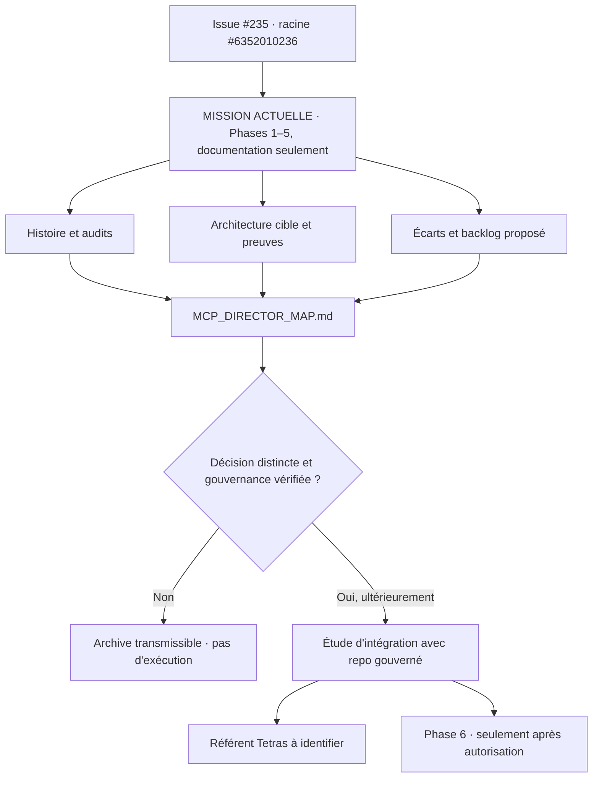

# Mandat documentaire fondateur — objectif autonome et passerelle future

> **Nature : mandat de connaissance, PAS un mandat d'exécution du programme MCP.** Document proposé dans [PR #348](https://github.com/Patricked-code/MCP/pull/348), sans fusion ni autorité runtime acquise. Racine unique : [issue #235, commentaire #6352010236](https://github.com/Patricked-code/MCP/issues/235#issuecomment-6352010236).

## Mission et finalité

Reconstituer et consolider **tout le patrimoine documentaire, architectural, décisionnel et technique** de `Patricked-code/MCP` depuis l'origine, pour qu'un agent ou une conversation nouvellement autorisée comprenne sans dépendre d'une mémoire de chat : (a) ce qui était envisagé, (b) ce qui a été essayé, (c) ce qui a été abandonné et pourquoi, (d) ce qui a été repris ailleurs, (e) ce qui est réellement prouvé, (f) ce qui reste à arbitrer. La mission doit aboutir à un **dossier canonique navigable et sourcé**, sans effacer les sources ni créer une autorité concurrente.

## Phases du mandat ACTUEL — toutes documentaires

1. **Histoire exhaustive** : issues, PR, reviews, commentaires, commits, branches, auteurs, dates, SHA, décisions, liens parent/successeur.
2. **Réconciliation des audits** : observations, risques, corrections, non-corrections, preuves, tests et incertitudes.
3. **Architecture cible consolidée** : versions historiques, [PR #95](https://github.com/Patricked-code/MCP/pull/95), contrats GWC, 94 blueprints, nouvelles idées, abandons et arbitrages en attente ; distinguer hypothèse, cible et implémentation.
4. **État réel / gap analysis** : code GitHub, tests, CI, Live State, outils, agents, BUS, mémoire, OIDC/OAuth, gouvernance et déploiement ; preuve exacte requise pour chaque conclusion.
5. **Plan de convergence documentaire** : réutiliser → réconcilier → compléter → améliorer → généraliser → étendre → créer si nécessaire ; dépendances, risques, ownership existant, propositions de tâches et critères d'acceptation, **sans matérialiser une nouvelle Task runtime**.

**Phase 6, hors mandat actuel** : admission/exécution multi-agents gouvernée, implémentation, dispatch, communication BUS, CI, déploiement et certification. La documentation de cette phase n'est ni son déclenchement ni une autorisation. Le lancement nécessitera une décision et les autorités gouvernées applicables.

## Livrables documentaires et preuves

- **Historique** : chronologie et graphe de provenance (source, décision, évolution, supersession, clôture).
- **Audits** : constat → cause → remédiation candidate → PR/commit → tests/CI → déploiement éventuel → verdict ou UNKNOWN.
- **Architecture** : état observé, cibles historiques, cible consolidée proposée, frontières d'autorité, mind map.
- **Réalisations** : statut `DONE/PARTIAL/DESIGNED/READY/BLOCKED/UNKNOWN/SUPERSEDED/ABANDONED` fondé sur preuves.
- **Agents/BUS** : inventaire des identités et responsabilités existantes, mémoire et continuité ; aucune identité documentaire n'accorde de droit runtime.
- **Backlog cible** : propositions non exécutables, liens vers le [Program Backlog V2](program-backlog-convergence.json), les [94 blueprints](architecture-94-blueprint-crosswalk-20261009.json) et la [carte PCM](mcp-priority-convergence-map-20261015.json).
- **Passation** : chaque lot laisse racine, parent, baseline SHA, périmètre, liens, conclusions et inconnues, prochaine action et critère d'arrêt dans l'[issue #235](https://github.com/Patricked-code/MCP/issues/235).

## Relation au « repo gouverné » et à « Tetras »

**Intention explicitement différée :** ce dossier servira de **source d'analyse et d'entrée pour une étude d'intégration ultérieure** avec le dépôt gouverné. Aucune fusion de gouvernance, migration, copie de secrets, écriture cross-repo ou modification de son modèle d'autorité n'est approuvée ici. L'intégration future devra commencer par identifier le dépôt exact, ses contrats d'entrée, ses propriétaires, ses autorisations et la compatibilité des artefacts ; produire une matrice `MCP artifact → governed repository interface → gap → decision`, puis soumettre un arbitrage indépendant.

**Tetras :** terme mentionné par l'opérateur comme point de rattachement souhaité. **Référent exact / dépôt / interface NON VÉRIFIÉS** à ce stade ; ne pas inventer de composant, d'identité ou de mécanisme nommé Tetras. Le lien documentaire demandé est enregistré ici comme **INTEGRATION_REFERENCE_PENDING_IDENTIFICATION**, à préciser avant toute liaison technique.

## Graphe de continuité

## Critères d'achèvement et NEXT_ACTION

Le mandat documentaire ne peut être déclaré terminé que si les périodes et types de sources sont couverts ou explicitement `UNKNOWN`, que les doublons et abandons sont liés à leurs successeurs, que les audits ont des verdicts traçables, que les architectures et divergences sont présentées sans les confondre avec l'état live, et que la passation est reproductible à froid.

**NEXT_ACTION** : relire les commentaires/reviews PR #40–64 ; compléter la matrice de provenance, puis les deltas #65+ ; vérifier la carte et ce mandat dans la PR #348 ; ne pas ouvrir la phase 6. Identifier séparément ce que désigne « Tetras » avant de créer une interface de liaison réelle.
