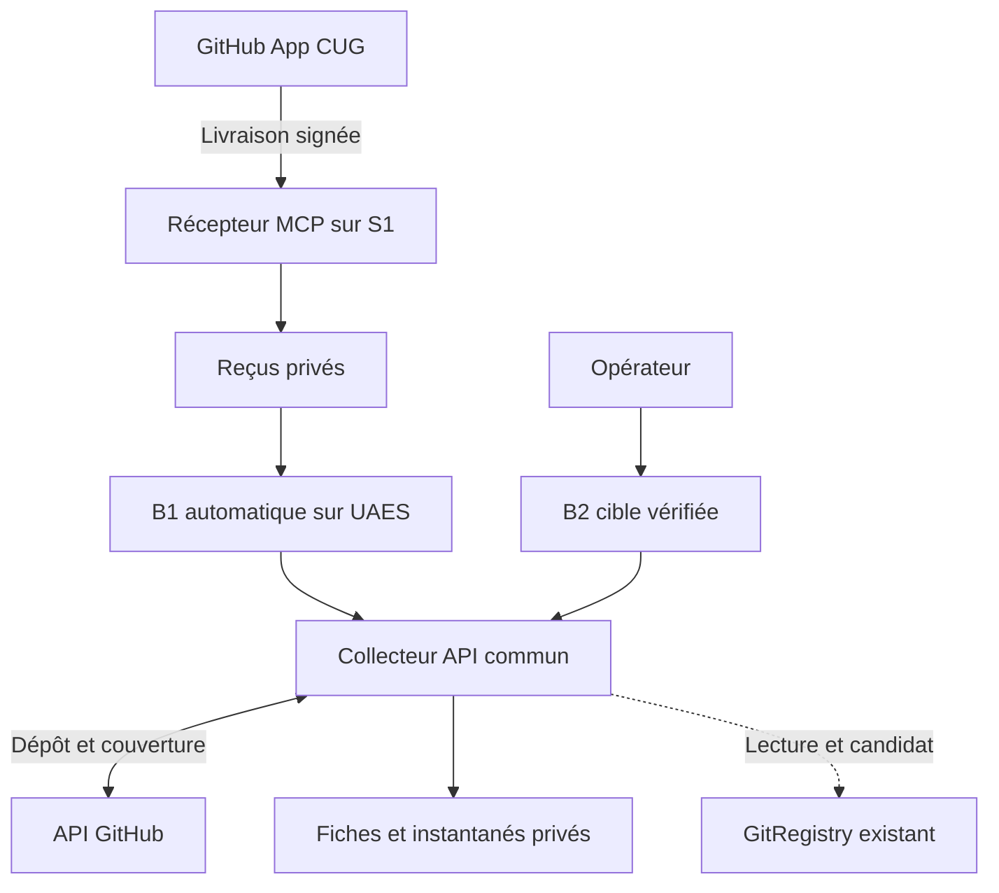

# Architecture du chantier CUG — WT-MCP-CUG-GRT-20261114-01

## Existant attesté

- [Récepteur #403](../../../../src/cug/webhook.ts) : contrôle de signature et de périmètre, déduplication par livraison, pas de collecte API dans la requête HTTP. `202` signifie reçu durable, pas fiche mise à jour.
- [Registre d'entrée](../../../../src/cug/discoveryRegister.ts) : reçus v1/v2, observation `PENDING_GITHUB_API` et proposition `REFRESH_GITHUB_INVENTORY`. Une observation ne donne aucun droit.
- [Collecteur #404](../../../../src/cug/pilotInventory.ts) : jeton borné en lecture, contrôle de couverture et recoupement des identifiants, fiche privée, lecture du GitRegistry. CUG confirmée sur la cible, autres Apps non vérifiées.
- [B1 #407](../../../../src/cug/receiptConsumer.ts) : projection périodique d'un reçu vers sa fiche, UAES seulement. Tous les reçus admissibles réutilisent le même collecteur ; ce n'est pas encore un routage métier par type d'événement.
- [B2 #411](../../../../src/cug/runScopedInventory.ts) : une cible explicite, une preuve privée, aucun élargissement d'abonnement. Une sortie positive ne prouve pas un rattachement serveur.
- [Admission #401](../../cug-grt-capsule.md) : `/repo-template/auth` et reprise GRT sont un autre parcours, sans déclenchement automatique par le webhook.

| Stockage existant | Identité de la preuve | Fonction |
| --- | --- | --- |
| `/app/data/cug-webhook-receipts` | `deliveryId` | Réception et déduplication |
| `/app/data/cug-pilot-inventory` | Empreinte d'instantané | Fiches opérateur UAES et B2 |
| `/app/data/cug-receipt-inventory` | `deliveryId` et empreintes | Résultat automatique lié à la livraison |

La clé privée d'App CUG pour la collecte ne se confond pas avec le secret de signature du webhook. Les fiches privées sont des preuves, pas un index canonique courant. Le GitRegistry reste distinct.

## Cible à concevoir — non livrée

Fonder l'inventaire sur **périmètre attendu → installation → dépôts couverts → observations et état vérifié → projections et vues**. Ajouter l'inventaire initial et la réconciliation périodique. Traiter perte de couverture, changements de nom ou transfert en revalidant l'identité stable et les droits. Ne rien déduire d'un échec de lecture. Concevoir les mises à jour de champs et le front-end à partir de la [cartographie](CARTOGRAPHIE.md), pas d'un branchement direct du webhook aux autorités de production.

Rattachement S1/S2, mise à jour GitRegistry, Plesk et création GRT gardent leurs contrôles respectifs. Une valeur GitHub n'écrase pas une observation serveur. Aucun stockage final, nouvel endpoint de consultation ou schéma SQL n'est arrêté par ce dossier.
